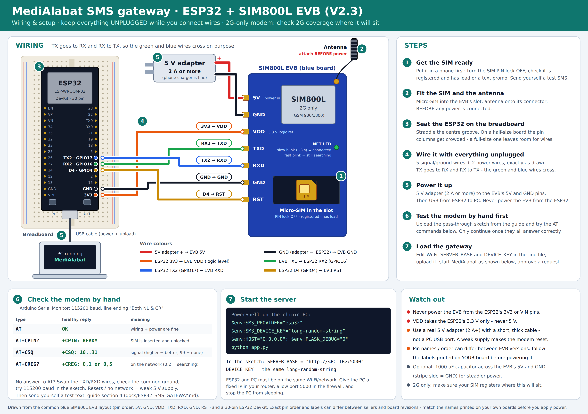

# ESP32 + SIM800L SMS gateway for MediAlabat

Texts patients when staff **approve** an appointment or ask them to **reschedule** it, using a SIM card in a
SIM800L module that an ESP32 controls.

```
 staff clicks Approve / Reschedule
            │
            ▼
   MediAlabat (Flask, on the clinic PC)         ESP32  ──UART──►  SIM800L  ──GSM──►  patient's phone
   saves the text in a queue (sms_outbox)  ◄──Wi-Fi──  asks every 5 s: "anything to send?"
                                                      sends it, then reports "sent" / "failed"
```

The ESP32 **asks the server**, the server never calls the ESP32. That means the board needs no fixed address,
nothing has to be opened on your network, and if the board, the SIM or the Wi-Fi is down the texts simply
wait in the queue (staff can see them on the **SMS Gateway** page) and go out when it's back.

---

## 1. Read this first: the SIM800L is 2G-only

The SIM800L can only use **2G (GSM 900/1800)**. Philippine networks are retiring it:

- The NTC ordered a phased shutdown of 2G and 3G (Memorandum Circular 003-09-2025), nationwide deadline **31 Dec 2026**.
- PLDT (Smart/TNT) has since been reported to be **delaying** its 2G shutdown, possibly to 2028 or later —
  see <https://context.ph/2026/04/06/pldt-delays-2g-shutdown-3g-exit-set-by-year-end/> and check the current status.
- **DITO has no 2G** at all, so a DITO SIM will not work in this module. I couldn't find a firm 2G date for Globe.
- Rural areas tend to keep 2G longest, but that is not a promise.

What this means in practice:

1. **Before you build anything, check 2G works where the module will sit** — put your intended SIM in the
   module (step 4 below) and see whether it registers (`AT+CREG?` → `0,1`) with decent signal (`AT+CSQ` ≥ 10).
   If it doesn't, nothing else in this guide will help; use a 4G module or Semaphore instead.
2. Treat the SIM800L as **fine for a prototype / pilot, risky for the long term.** The server side doesn't
   care what the modem is. A 4G module from the SIMCom A7670 / SIM7600 family speaks the same
   `AT+CMGF` / `AT+CMGS` commands, so moving later should mean small changes to `Sim800::init()` — but I haven't
   tested that, and you must check the module supports the bands your carrier uses.
3. You can flip between this gateway and Semaphore at any time with one environment variable (section 8).

---

> ### Which SIM800L do you have? The wiring is different.
> - **Blue "SIM800L EVB" board** (a larger board that says *EVB* on it — e.g. **EVB V2.3**): follow **3A** below and the picture
>   `docs/wiring_diagram.png`. It has its own power circuit (you feed it **5 V**) and a level-shifter (you give its **VDD** pin the
>   ESP32's 3.3 V), so it needs **no resistor divider and no 4.0 V supply**.
> - **Small bare red "SIM800L v2" module** (no EVB, tiny board): follow **3B**.
>
> *(An earlier version of this guide only described the bare module. If you already wired an EVB board with a 4.0 V supply, rewire it
> as in 3A — a diode-dropped 4 V would starve the modem and make it reset.)*

## 2. Parts

| Part | Notes |
|---|---|
| ESP32 dev board | Any "ESP32 Dev Module" style board (30 or 38 pin). |
| SIM800L board | **EVB** (blue) or bare **v2** module, with its antenna. The antenna must be connected before powering up. |
| Micro-SIM | **Not** nano. Prepaid is fine (see section 7). |
| **Power for the SIM800L** | **EVB board:** a **5 V adapter rated 2 A or more** (a phone charger is fine) with a short, thick cable. **Bare module:** see the warning below — either a single 3.7 V LiPo (≥ 2000 mAh), or a 5 V → **4.0 V** buck converter rated ≥ 2 A (e.g. LM2596 module, turned to 4.0 V *before* connecting the SIM800L). |
| Capacitors | 1000 µF (≥ 470 µF is OK), 10 V or more, right at the SIM800L's VCC/GND, plus 100 nF. |
| Resistors | 1.2 kΩ and 3.3 kΩ (for the RX level divider). |
| Jumper wires, USB cable | |

> ### ⚠️ Power is the #1 reason these projects fail
> The SIM800L needs **3.4 – 4.4 V** and pulls **up to ~2 A in short bursts** when it transmits.
> - **Do not** power it from the ESP32's 3.3 V pin (too low, too weak) or from 5 V (too high — it can destroy it).
> - A weak supply shows up as the module **rebooting every time it tries to send**, or never registering.
> - Keep the supply wires short and put the big capacitor right on the module's pins.

---

## 3. Wiring



*(`wiring_diagram.png` / `.svg` in this folder: the whole setup on one page — print it for the bench.)*

### 3A. SIM800L **EVB** board (blue) — what the picture shows

Pin order on the common EVB layout: `5V · GND · VDD · TXD · RXD · GND · RST`. **Follow the names printed on your own board** —
sellers and revisions differ.

| EVB pin | Connect to | Notes |
|---|---|---|
| **5V** | 5 V adapter **+** | 2 A or more. The board drops this to the modem's voltage itself. **Not** an ESP32 pin. |
| **GND** (either) | 5 V adapter **−** | |
| **GND** (the other) | ESP32 **GND** | **All grounds must be joined** — the two GND pins are tied together on the board. |
| **VDD** | ESP32 **3V3** | Tells the board's level-shifter to use 3.3 V signals. **Never 5 V here.** If your board has no VDD pin, skip this wire. |
| **TXD** | ESP32 **GPIO16** (RX2) | Module → ESP32. |
| **RXD** | ESP32 **GPIO17** (TX2) | ESP32 → module. **Directly — no divider needed.** |
| **RST** | ESP32 **GPIO4** | Lets the sketch reset a stuck modem. |

Power the ESP32 separately from USB. **Never** power the EVB from the ESP32's 3V3/VIN pins. Optionally put a 1000 µF capacitor
across the EVB's 5V and GND (stripe side = GND). The pass-through test and the sketch use the same pins (16/17/4) for both boards.

> I couldn't find the manufacturer's datasheet for the "V2.3" revision; the 5 V input and the VDD-as-logic-reference arrangement
> come from the commonly sold blue EVB layout and builders' write-ups. If anything on your board is labelled differently
> (or says to feed it a different voltage), trust the board's own labels/seller notes and tell me — I'll adjust the picture.

### 3B. Bare red SIM800L module (no EVB)

| SIM800L pin | Connect to | Notes |
|---|---|---|
| **VCC** | 4.0 V supply **+** | Not an ESP32 pin. |
| **GND** | Supply **−** **and** ESP32 **GND** | **All grounds must be joined.** |
| **TXD** | ESP32 **GPIO16** (RX2) | Module → ESP32. |
| **RXD** | ESP32 **GPIO17** (TX2) **through a divider** | See below. |
| **RST** | ESP32 **GPIO4** | Lets the sketch reset a stuck modem. |

**RXD divider:** the module's logic level is about 2.8 V; the ESP32 outputs 3.3 V. Wire
`GPIO17 ── 1.2 kΩ ──┬── SIM800L RXD` and `┬── 3.3 kΩ ── GND` (≈ 2.4 V at RXD). Many boards tolerate 3.3 V directly,
but the divider costs two resistors and removes the doubt — check your board's documentation if you want to skip it.
TXD → ESP32 needs nothing extra (2.8 V is read as "high" by the ESP32).

```
 4.0 V supply (+) ─────────────────── SIM800L VCC     (1000 µF + 100 nF across VCC/GND, close to the module)
 supply (−) ──┬─────────────────────── SIM800L GND
              └─────────────────────── ESP32 GND
 ESP32 GPIO16 (RX2) ◄───────────────── SIM800L TXD
 ESP32 GPIO17 (TX2) ──[1.2k]──┬──────► SIM800L RXD
                              └─[3.3k]─ GND
 ESP32 GPIO4 ─────────────────────────► SIM800L RST
```

Power the ESP32 from USB as usual; the SIM800L has its own supply.

---

## 4. Bring-up: talk to the modem by hand first

Prepare the SIM first: put it in a normal phone, **turn off the PIN lock**, make sure it's registered
(SIM registration is required in the Philippines) and has load or a text promo, and confirm it can send an SMS.

Then flash this tiny pass-through sketch so you can type AT commands in the Arduino **Serial Monitor**
(115200 baud, line ending **Both NL & CR**):

```cpp
HardwareSerial modem(2);
void setup() {
  Serial.begin(115200);
  modem.begin(9600, SERIAL_8N1, 16, 17);     // try 115200 here if you get no answers
}
void loop() {
  while (modem.available()) Serial.write(modem.read());
  while (Serial.available()) {
    char c = Serial.read();
    modem.write(c == '~' ? 26 : c);           // type ~ to send Ctrl+Z (the Serial Monitor can't)
  }
}
```

Try, in order:

| Type | Healthy reply | Meaning |
|---|---|---|
| `AT` | `OK` | Wiring and baud rate are right. |
| `AT+CPIN?` | `+CPIN: READY` | SIM is inserted and unlocked. |
| `AT+CSQ` | `+CSQ: 15,0` | Signal 0–31. Aim for **10 or more**; `99` = none. |
| `AT+CREG?` | `+CREG: 0,1` (or `0,5`) | Registered on the network. `0,2` = still searching. |
| `AT+COPS?` | `+COPS: 0,0,"SMART"` | Which network you're on. |

Then send yourself a test text:

```
AT+CMGF=1
AT+CMGS="+639171234567"        ← your own number; wait for the  >  prompt
Hello from the clinic~          ← the ~ sends Ctrl+Z
```

You should get `+CMGS: <number>` and `OK`, and the text on your phone. **If this works, the hardware is done.**
The network LED on the module blinks about every 3 s once registered (every ~1 s while searching).

---

## 5. Set up the server

On the PC that runs MediAlabat, choose a long random key and start it with these environment variables.
(`HOST=0.0.0.0` lets the ESP32 reach it; **`FLASK_DEBUG=0` is important** — debug mode on a network is unsafe.)

Windows PowerShell:
```powershell
$env:SMS_PROVIDER="esp32"
$env:SMS_DEVICE_KEY="paste-a-long-random-string-here"
$env:HOST="0.0.0.0"
$env:FLASK_DEBUG="0"
python app.py
```
Mac/Linux:
```bash
SMS_PROVIDER=esp32 SMS_DEVICE_KEY=paste-a-long-random-string-here HOST=0.0.0.0 FLASK_DEBUG=0 python app.py
```

Then:
1. Find the PC's address (`ipconfig` → IPv4, e.g. `192.168.1.50`) and **reserve it in your router** (DHCP reservation)
   so it doesn't change. The ESP32 has this address baked in.
2. Allow the app through the Windows firewall (choose **Private** networks when prompted). Check by opening
   `http://192.168.1.50:5000` on a phone on the same Wi-Fi.
3. The PC must stay **awake** — turn off sleep while plugged in.

**Test the server side with no hardware at all:**
```bash
python tools/fake_gateway.py --key paste-a-long-random-string-here
```
Approve or reschedule a request in the staff pages and watch the fake gateway "send" it; the **SMS Gateway** page
(`/staff/sms`, also linked on the staff dashboard) shows it go *Pending → Sent*. `--fail-every 2` shows the retries.
`python tools/test_sms_gateway.py` runs the automated server checks (on a throwaway database).

---

## 6. Flash the gateway

1. Arduino IDE → *Boards Manager* → install **esp32 by Espressif Systems**. Board: **ESP32 Dev Module**.
2. Open `esp32_sms_gateway/esp32_sms_gateway.ino` — keep `sim800_sms.h` **in the same folder**.
   No extra libraries are needed.
3. Edit the top of the file: `WIFI_SSID`, `WIFI_PASS`, `SERVER_BASE` (`http://192.168.1.50:5000`),
   and `DEVICE_KEY` (the **same** string as `SMS_DEVICE_KEY`). Pins match the wiring above.
4. Upload, open the Serial Monitor at **115200**. A healthy start looks like:
   ```
   [wifi] connecting to MyWifi .. ok, IP 192.168.1.77
   [modem] reset, waiting for it to boot...
   [modem] waiting for the network (can take up to a minute)...
   [modem] registered, signal 17/31
   [sms] #1 -> +639171112222 : MediAlabat: Your appointment at ... APPROVED. ...
   [sms] #1 sent
   ```
5. In MediAlabat, approve a request for a patient whose number is your own → the text arrives and the
   **SMS Gateway** page shows *Online* and the message as *Sent*.

---

## 7. Running it for real

- **SIM:** keep load / a text promo on it; low volume (a few texts per appointment) is fine, but telcos can
  flag a SIM that sends lots of automated texts — don't use it for bulk messaging.
- **One SMS = 160 characters.** The gateway cleans every text to plain ASCII on one line and cuts it at 160. The
  *Reschedule* wording leaves room for a clinic name of about **26 characters**; longer names get the end of the text
  trimmed (status, clinic, date and time are always kept). Keep clinic names short.
- **Phone numbers** must be Philippine mobiles (`09XXXXXXXXX`, `+639XXXXXXXXX`). Anything else is recorded as *failed*
  on the status page instead of silently disappearing.
- **Where to put it:** near a window, antenna clear of the ESP32 and the supply wires.
- **Security:** keep this on your LAN — don't port-forward the server to the internet. The device key stops anyone else on
  the network from reading or marking queued texts. The texts contain only clinic, date, time and status — keep it that way.

### Staff passcodes use this gateway too
Doctor/staff login and sign-up codes (see the README) are sent through the same queue. If the gateway is offline, staff
can't receive their code and can't log in until it's back — keep the board running, or use `STAFF_OTP_REQUIRED=0` for
emergencies. Codes expire after 5 minutes, so a long outage means asking for a fresh one ("Send a new code").
Before switching to this gateway, make sure every staff account has a real mobile number saved.

### What happens when things go wrong

| Situation | Result |
|---|---|
| ESP32 / Wi-Fi / SIM off or out of signal | Texts wait as *Pending*; the page shows the gateway *Offline*. They send when it's back. |
| Server PC off | The ESP32 keeps retrying; nothing is lost (the queue is in the database). |
| Network rejects a text | Reported as failed, retried, **up to 3 attempts**, then marked *Failed* with the modem's error text. |
| ESP32 loses power mid-send | The text is re-offered after 3 minutes. **Rarely this can send the same text twice** — chosen over silently never notifying a patient. |
| Modem keeps failing | The sketch resets it (RST pin) and re-registers. |

### Switching providers
Unset `SMS_PROVIDER` (and set `SEMAPHORE_API_KEY`) to go back to Semaphore. Set `SMS_PROVIDER=console` to just print texts.
Texts already queued stay in the database.

---

## 8. Troubleshooting

| Symptom | Likely cause |
|---|---|
| `no answer to AT` | TX/RX swapped; no common ground; wrong baud (try 115200 in the sketch); module not powered. |
| Module resets when sending / never registers | **Power.** EVB: a real 5 V adapter with ≥ 2 A and a short, thick cable (not a PC USB port). Bare module: proper 4.0 V supply with ≥ 2 A. Either way a bigger capacitor and shorter wires help. |
| `+CREG: 0,2` forever | Antenna missing/loose; no 2G coverage; SIM not registered or no load. |
| `+CREG: 0,3` | Registration denied — SIM blocked/unregistered. |
| `+CPIN: SIM PIN` / `not ready` | Turn off the SIM's PIN in a phone first. |
| `+CMS ERROR: 330` or `smsc` problems | The SMS centre number isn't set; check `AT+CSCA?` and set the one for your carrier. |
| `+CMS ERROR: 500` / others | Often no load, or the network blocked the send. |
| `[http] poll failed (-1)` | Wrong `SERVER_BASE`; server not started with `HOST=0.0.0.0`; firewall; different Wi-Fi network. |
| `[http] poll failed (403)` | `DEVICE_KEY` ≠ `SMS_DEVICE_KEY`, or `SMS_DEVICE_KEY` isn't set on the server. |
| Page shows *Offline* but the board is running | Same as above — the board isn't reaching the server. |
| Texts arrive garbled | Non-ASCII text — shouldn't happen (cleaned server-side); check the SIM's charset with `AT+CSCS?`. |

---

## 9. What's in the project

| Path | What it is |
|---|---|
| `sms_gateway.py` | The queue: number/text cleaning, claiming, retries, leases, status. |
| `app.py` | `GET /api/sms/next`, `POST /api/sms/<id>/result` (for the board), `/staff/sms` (status page). |
| `esp32_sms_gateway/` | The sketch (`.ino`) and the modem code (`sim800_sms.h`). |
| `tools/fake_gateway.py` | Pretend gateway for testing without hardware. |
| `tools/test_sms_gateway.py` | Automated checks of the server side. |
| `tools/esp32_host_test/` | Compiles `sim800_sms.h` on a PC against a simulated SIM800L and checks it, incl. error cases:<br>`g++ -std=c++17 -I tools/esp32_host_test -I esp32_sms_gateway tools/esp32_host_test/test_sim800.cpp -o t && ./t` |

**Honest limits:** the server code, the modem logic (against a simulated modem) and a compile of the sketch against
stand-ins for the ESP32 APIs have been tested. The sketch has **not** been run on real ESP32/SIM800L hardware or a real
Philippine network, so expect to tune things (baud rate, delays, power) during bring-up.
